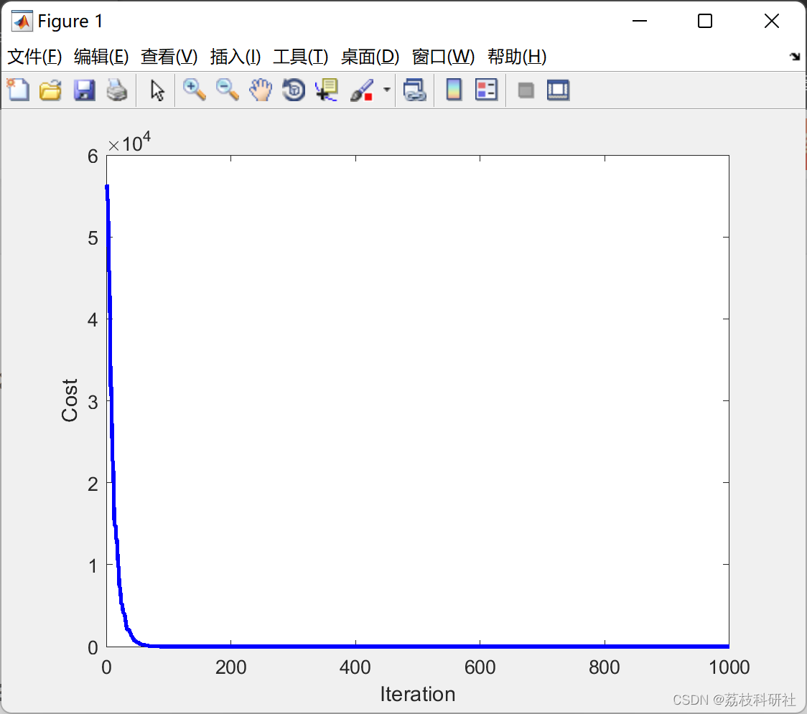

# Optimization algorithm based on human behavior, powerful metaheuristics for solving complex optimization problems (Matlab code implementation)

The algorithm consists of the following five steps:
1. Initialization
2. Education
3. Consultation
4. Field change probability
5. Completion
📚2 Run results editing
Partial code:
clc;
clear all;
%% Problem Definition
nVar=30;    %number of variables %Diamention of the problem 
CostFunction=@BenchmarkFunction;  
VarMin=[-100];  
VarMax=[100];  
VarSize=[1 nVar];  
VarRange=[VarMin VarMax];  
%% HBBO Parameters
nIterations=1000;  %number of iterations  
nPop=150;      %number of all Individuals  
nField=30;%round(nPop/5); %=number of Fields  
K1=0;  
K2=2.5;  
Sigma=0.2;  
Mode=1;  % Advanced Mode=1  Simple Mode=2  
%% Stoping Conditions  
FunctionTolerance=1e-6;  
FitnessLimit=-inf;  
StallIteration=1000000;  
Plot=1; %Plot=1 if you want to plot the results
Parameters;  
%% Initialization  
Field=Initialization();  
tic;  
%% APA Algorithm Main Body  
for i=1:nIterations  
Field=Education(Field);  
Field=Consultation(Field);  
Field=FieldChanging(Field);  
Field=Evaluation(Field);  
AllIndividuals=[];  
AllIndividualsCosts=[];  
for ii=1:nField  
if Field(ii).nInd~=0      %baraye errore zard rang ke mige empty darim  
AllIndividuals=[AllIndividuals  
Field(ii).Individuals];  
end  
end  
AllIndividualsCosts=[AllIndividuals.Cost];  
[LeastCost,ANSIndex]=min(AllIndividualsCosts);  
PerfectInd=AllIndividuals(ANSIndex);  
MeanCost(i)=mean(AllIndividualsCosts);  
%% Stoping Criteria  
Best.Position=PerfectInd.Position;  
BestSolution=PerfectInd.Cost;  
BestCost(i)=BestSolution;  
disp(['Iteration=' num2str(i) '  Best Cost=' num2str(BestCost(i))])  
% Fitness Limit  
if BestCost(i)<=FitnessLimit  
break  
end  
% Stall Generation  
if i>StallIteration  
dif=BestCost(i)-BestCost(i-StallIteration);  
if dif<FunctionTolerance  
break  
end  
end  
end  
toc;  
%% Showing Results  
if Plot==1  
figure;  
plot (BestCost,'b','LineWidth',2);  
%semilogy(BestCost,'b','LineWidth',2);  
hold on;  
% plot (MeanCost,'r','LineWidth',1);  
%semilogy(MeanCost,'r','LineWidth',1);  
xlabel ('Iteration');  
ylabel ('Cost');  
end  
disp(['Final Cost=' num2str(BestSolution)]);  
if Mode==2  
disp('Optimization with HBBO in Simple Mode Completed');
else
disp('Optimization with HBBO in Advanced Mode Completed');
end
🌈3 Matlab Code Implementation
🎉4 References

## Images

<!-- PAYMENT_BLOCK -->

## Get this dataset

- Payment link (Stripe): [Buy now](https://buy.stripe.com/3cs8yP7sY87d0vu9AB)
- Payment QR code: 

<!-- /PAYMENT_BLOCK -->
